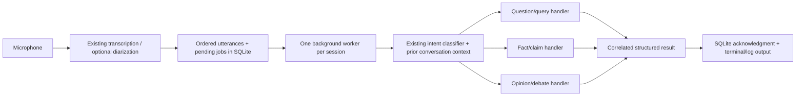

# Phase 0 and Phase 1 implementation

> Superseded by the live-testing repairs in
> [PHASE_0_1_RELIABILITY_REPORT.md](PHASE_0_1_RELIABILITY_REPORT.md).
> This document records the initial implementation; capture, segmentation,
> preload behavior, and validation results have since changed.

Date: 18 November 2026 (Asia/Calcutta).

## Outcome

The live application now has a chronological, SQLite-backed conversation pipeline
with intent classification, three routing destinations, durable retry state, and
bounded worker shutdown. Existing speech-model selection, language options,
transliteration, and terminal previews are preserved. The Whisper library's model,
decoding, timing, tokenizer, and normalizer implementation was left unchanged.

Phase 0 repairs and Phase 1 routing/storage are implemented. Full speech/model/API
integration still needs the checks listed below. The architecture's retrieval,
panel, ethics, feedback, analytics, and audience-delivery features remain later work.

## Completed Phase 0 work

- Removed erroneous `whisper.logger` imports. Application logging consistently uses
  the existing root `logger.py`; its default destination is inside the repository.
  Log responses include correlation input, and OS file locking keeps multiline
  entries together across capture and worker processes.
- Removed the undeclared `../whisperx` path dependency. `diarization.py` adapts the
  pyannote 4 API already available in the environment and assigns segment/word
  speakers by overlapping durations. Optional model/dependency/access failures
  retain the no-diarization fallback. Unmatched speech remains `UNKNOWN`.
- Replaced the classifier import-time demonstration with offline tests. Added a
  regression for mock multi-label output and made it consistent with model output.
- Replaced advance-before-success dispatch pointers with transactional SQLite
  claims and acknowledgments. Exceptions preserve errors and retry up to three
  total attempts, with exponential delay. Exhausted jobs remain inspectable.
- Disabled nested SDK retries and set an explicit configurable HTTP timeout.
  Empty model responses become retriable errors rather than successful results.
- Added `finally` cleanup to both live scripts. Remaining audio is finalized after
  capture stops; unsuccessful tail submission saves a local recovery artifact.
  The worker drains jobs within a deadline, then terminates if needed, preserving
  unresolved work for restart. There is no Manager server or unbounded LLM thread
  creation to clean up.
- The basic live script now uses the same background dispatch as the diarized
  script; model API latency no longer blocks its audio-consumption loop.
- Deferred speech/native-library imports so live modules and `--help` work without
  model initialization. Added missing-configuration checks before capture.
- Added dependency extras/files, `.env.example`, runtime artifact ignore rules,
  test markers, and application setup/run/test documentation. Existing `.env`
  credentials were not read or overwritten.

## Completed Phase 1 work

- `conversation.py`: durable sessions, stable utterance IDs, chronological sequence,
  speaker, original/display text, language and available audio times; bounded prior
  context; atomic multi-utterance submission; jobs, results, errors, attempt counts,
  retry eligibility and crash-recovery leases.
- `orchestrator.py`: the existing `SentenceClassifier` is now called from the worker
  with routing labels for question, query, fact, claim, opinion, debate, and neutral
  statement. Uncertain/unknown/neutral outputs abstain with `needs_clarification`.
- Dedicated handlers support `questions`, `claims`, and `opinions`. Injected handlers
  receive the current turn and bounded chronological prior context. Results retain
  their session, utterance, sequence, speaker, intent scores, route, and context IDs.
- Facts/claims reuse the original Groq model call through `llm_client.py`, explicitly
  marked `unverified`. Question retrieval and the debate panel have honest
  `unavailable` responses until their later phases are implemented.
- `live_runtime.py`: both live adapters share ordered segment submission. Word-level
  speaker changes preserve A/B/A ordering rather than merging all A speech together.
  Punctuation splits multi-sentence text; original text is stored alongside display
  transliteration. Resumed live input continues after the stored session timeline.
- `session_lock.py`: a local OS lock rejects concurrent pipelines for one session.
  SQLite transaction ownership additionally prevents stale workers from acknowledging
  another worker's job. In-flight work has an expiry lease after abrupt failure.
- `pipeline_cli.py`: JSONL replay, explicit offline demonstration mode, session
  resumption, and inspection of persisted jobs/results. Stable input IDs make replay
  idempotent; a sample conversation is in `tests/fixtures/conversation.jsonl`.

## Validation

Full default suite: **55 passed, 1 skipped, 22 deselected**.

- The skip is the original file-audio test: `ffmpeg` is absent from PATH. It now
  reports this prerequisite explicitly.
- The 22 deselected cases are the existing model-download transcription and
  CUDA-only timing tests, now explicitly excluded from ordinary offline runs.
- Tested classifier contracts, all six intent aliases, confidence abstention,
  chronological/session-isolated/bounded context, persistence, idempotent input,
  atomic chunk rollback, backlog limits, retries, exhaustion, lease recovery,
  acknowledgment ownership, and injected handlers.
- Exercised real Windows `spawn` workers: drain-on-stop, forced termination,
  resumption, no repeated successful dispatch, and duplicate-session rejection.
- Exercised both live adapters with fake audio/model inputs for Ctrl+C finalization
  and microphone errors; verified cleanup, original transcript retention, ordered
  word speakers, tail-audio recovery artifacts, and lightweight import/help paths.
- Tested offline replay/inspection as subprocesses, replay deduplication, HTTP-client
  timeout/retry configuration, and concurrent multiline logging.
- Existing CPU timing, normalizer, and tokenizer tests pass.
- All 34 Python source files parse; declared application module paths exist.
- `pip check`: no broken requirements. Real imports of `transformers.pipeline`,
  `pyannote.audio.Pipeline`, and `faster_whisper` succeed without loading weights.

The existing Python 3.14.5 virtual environment was used. Installed pytest 9.2.0 and
transformers 4.57.6; its resolver selected huggingface-hub 0.36.2 and tokenizers
0.22.2. Other inspected versions include pyannote.audio 4.0.7, faster-whisper 1.2.1,
openai 3.14.0, numpy 2.5.3, and torch 2.14.0. These are the tested installed versions,
not a claim that every hardware/model integration has been certified or that a
complete transitive dependency lock has been produced.

## Limits and remaining checks

1. **Hardware and external integrations:** no microphone recording, speech/ModernBERT
   model inference, gated diarization download, GPU execution, or live Groq request
   was performed. Install `ffmpeg` for the original file decoder and run the explicit
   integration tests and a short two-speaker English/Hindi recording locally.
2. **Evidence and panel scope:** routing is implemented, but retrieval/citations and
   specialist panel reasoning are not. An `unavailable` result is a successfully
   handled Phase 1 route, not a completed answer or panel analysis. Existing model
   fact assessments remain unverified until evidence retrieval is added.
3. **Classification quality:** the default 0.5 confidence threshold and overlapping
   labels require evaluation on actual English/Hindi/Hinglish turns. No accuracy
   claim follows from mock tests. Offline replay rules are demonstration-only.
4. **Segmentation/speaker accuracy:** punctuation splitting is deliberately simple;
   sentence parts inherit their source segment span. Rolling-window speaker labels
   can change; stable speaker identities require later evaluation/implementation.
   Shutdown tail transcription uses `UNKNOWN` attribution.
5. **External delivery semantics:** completed jobs do not replay, but a crash between
   a remote response and the SQLite commit can repeat that external request. This
   implementation provides at-least-once execution, not exactly-once LLM calls.
6. **Shutdown/recovery:** the 20-second deadline covers worker draining. Initial model
   loading and final tail transcription are synchronous and can take longer. An
   abrupt crash can require waiting for the prior in-flight lease (at least 120
   seconds); explicit shutdown releases that worker's jobs after it stops. Permanent
   failures retain their attempt counts and need deliberate operator review.
7. **Retention:** memory used for reasoning and pending work is bounded, but persisted
   session history/logs are not automatically pruned. Retention policy, authentication,
   tamper-evident audit, and analytics remain outside these phases.
8. **Repository status:** Git metadata was inaccessible under the workspace sandbox,
   so no commit, diff-status claim, or deployment was made. Changes remain in the
   workspace for review.

## Next steps

1. Run the documented microphone/model/API smoke checks and verify the configured
   model IDs/access. Use `--inspect` to confirm turn order, routing and failures.
2. Build a small labeled multilingual intent set and tune confidence/abstention.
3. Start Phase 2 with a small curated evidence corpus and one retrieval interface.
   Replace the question `unavailable` handler and claim `unverified` assessment with
   cited answers and evidence-backed per-claim verdicts using the existing handler
   and result contracts.
4. Implement the opinion/debate panel after the evidence path works. Define the
   diagram's ethics rubrics explicitly before adding scores or feedback loops.

Run commands and configuration examples are in the application section at the top
of [README.md](README.md). The original temporary review remains available as a
historical pre-implementation architecture assessment.
